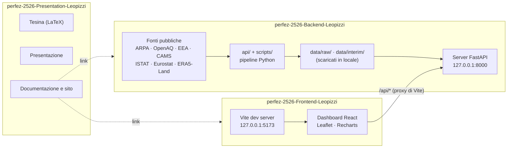

# OneHealth — Backend

> Cruscotto di supporto decisionale per presidi medici e aziende sanitarie pubbliche e private, che affianca per zona e nel tempo **qualità dell'aria**, **calore urbano** e **salute** nel Salento (province di Lecce, Brindisi e Taranto, 20 distretti socio-sanitari e 145 comuni), usando solo **dati pubblici**: nessun hardware, nessuna rilevazione sul campo, nessuna interfaccia per il cittadino. La correlazione fra i domini è sempre **esplorativa, non causale**. Include ONE, un assistente che gira in locale (LLM open-source preaddestrato più RAG) e guida verso politiche di medicina di iniziativa.

## Il progetto in tre repository

| Repository | Contenuto |
|---|---|
| [perfez-2526-Presentation-Leopizzi](https://github.com/UniSalento-IDALab-corsoPerfez-25-26/perfez-2526-Presentation-Leopizzi) | tesina, presentazione, documentazione, ricerca |
| [perfez-2526-Backend-Leopizzi](https://github.com/UniSalento-IDALab-corsoPerfez-25-26/perfez-2526-Backend-Leopizzi) | client delle fonti, pipeline, API locale, assistente ONE ← sei qui |
| [perfez-2526-Frontend-Leopizzi](https://github.com/UniSalento-IDALab-corsoPerfez-25-26/perfez-2526-Frontend-Leopizzi) | dashboard e mockup |

## Architettura



## Come si collega agli altri repository

- **Backend**: espone `/api` su `127.0.0.1:8000`; lo schema è in `docs/openapi.json`. **Non contiene dati**: li scarica dalle fonti pubbliche.
- **Frontend**: `npm run dev` apre `127.0.0.1:5173` e gira ogni chiamata `/api/*` al Backend (variabile `ONEHEALTH_API_URL`). Il collegamento è **solo HTTP**: nessuno dei due importa file dell'altro; il contratto è lo schema OpenAPI.
- **Presentation**: documenta il progetto e rimanda agli altri due; nessun codice eseguibile.
- **Versioni**: Backend e Frontend vanno insieme alla stessa versione dell'API (oggi **0.2.0**, tag `v1.0.0` alla consegna).

Si consiglia di clonare i tre repository nella stessa cartella:

```text
OneHealth/
├── perfez-2526-Backend-Leopizzi/
├── perfez-2526-Frontend-Leopizzi/
└── perfez-2526-Presentation-Leopizzi/
```

## Struttura del repository

```text
api/                client delle fonti e pipeline (package Python, import assoluti)
  comune/           distretti, confini, anagrafiche, stati, aggregazione, celle → comuni
  aria/             ARPA, OpenAQ, EEA, CAMS: client, adattatori (fonti/), archivio incrementale
  salute/           ISTAT, Eurostat, Health for All, simulazione
  calore/           ERA5-Land, ARPA meteo, CLMS, soglie
scripts/            script eseguibili: aria/, calore/, salute/, territorio/, dashboard/, rag/, backend/
localhost/server/   API FastAPI (il percorso resta così per non rompere gli import)
localhost/rag/      assistente ONE: client Ollama, documenti/, analisi, schede dei fatti
data/territorio/    anagrafica, confini e elenchi dei distretti (riferimenti, non misure)
data/dataset/       anagrafiche di stazioni e inquinanti e altri file di riferimento
docs/               Regole_dei_dati, Architettura, Endpoint, openapi.json, fonti/ (schede delle fonti)
ATTRIBUZIONI.md     fonti, licenze e attribuzioni
.env.example        nomi delle variabili d'ambiente (senza valori)
```

## Avvio

Serve [uv](https://docs.astral.sh/uv/). Dalla radice del repository:

```powershell
uv sync                                                  # crea .venv con le dipendenze
copy .env.example .env                                   # e inserire le proprie chiavi
uv run --env-file .env scripts/backend/prepara_dati.py   # la prima volta: scarica i dati (v. «Dati»)
uv run localhost/server/main.py                          # http://127.0.0.1:8000  (documentazione su /docs)
```

Il server **parte anche senza dati**: gli endpoint rispondono «non ancora scaricato» e `GET /api/stato` dice cosa c'è in locale. Se la porta 8000 è occupata: `ONEHEALTH_PORT`. Variabili d'ambiente (tutte facoltative tranne le chiavi, v. `.env.example`): `ONEHEALTH_HOST`, `ONEHEALTH_PORT`, `ONEHEALTH_ORIGINI` (origini del Frontend ammesse), `ONEHEALTH_LLM`, `OLLAMA_HOST`.

Lo schema OpenAPI si riesporta con `uv run scripts/backend/esporta_openapi.py` (scrive `docs/openapi.json` e `docs/Endpoint.md`).

## Dati

Il repository **non contiene dati scaricati**: chi lo clona li scarica dalle fonti pubbliche. `prepara_dati.py` lancia nell'ordine giusto gli script sotto, su un periodo scelto (`--da`, `--a` in `AAAA-MM-GG`; default: l'ultimo mese completo, così una prima prova finisce in tempi ragionevoli), salta i passi per cui manca una chiave dicendo come ottenerla e non si ferma se un passo fallisce. `--dry-run` mostra cosa farebbe.

| Passo | Script | Chiave / account | Note |
|---|---|---|---|
| 1. Aria CAMS (modellata) | `scripts/aria/scarica_cams.py` | `COPERNICUS_API_KEY` + licenze ADS accettate a mano sul sito | minuti per richiesta, ore per anni |
| 2. Aria ARPA, OpenAQ, EEA | `scripts/aria/genera_dataset_aria.py` | `OPENAQ_API_KEY` (account gratuito; senza, OpenAQ resta `NULL`) | un mese per file; riprendibile |
| 3. Calore ERA5-Land | `scripts/calore/scarica_era5_land.py` | `COPERNICUS_API_KEY` + licenza CDS accettata a mano | ore; riprendibile |
| 4. Calore ARPA meteo | `scripts/calore/scarica_arpa_meteo.py` | nessuna | minuti |
| 5. Decessi ISTAT | `scripts/salute/scarica_decessi_istat.py` | nessuna | minuti |
| 6. Dimissioni ISTAT (HFA) | `scripts/salute/scarica_dimissioni_hfa.py` | nessuna | secondi |
| 7. Dati sanitari simulati | `scripts/salute/simula_dati_salute.py` | nessuna | richiede aria CAMS e ERA5-Land |
| 8. Viste della dashboard | `scripts/dashboard/prepara_consuntivi.py`, `prepara_stagionalita.py` | nessuna | sempre in locale: sono file `pickle`, non si scambiano fra macchine |

Aggiornamento quotidiano dell'aria: `uv run --env-file .env scripts/aria/genera_dataset_aria.py --continua`. Dopo ogni aggiornamento si rilanciano le viste (passo 8) e si riavvia il server. Per rifare `mitigazione_comuni.json` (facoltativo, già nel repository) serve `scripts/calore/calcola_mitigazione_comuni.py` e i raster CLMS scaricati a mano con un account EU Login (1,1 GB).

**Cosa si vede con quali dati.** Con i soli passi senza chiave (4, 5, 6) la dashboard ha calore ARPA, decessi e dimissioni ma la mappa dell'aria resta `N/D`; con il passo 2 compaiono le fonti misurate; con il passo 1 anche gli 8 distretti senza stazioni (dato modellato).

## L'assistente ONE

ONE usa **Qwen3.5 4B** (Apache-2.0) eseguito in locale con [Ollama](https://ollama.com/): nessun servizio esterno. Senza Ollama il resto funziona e la chat mostra i soli dati calcolati.

```powershell
winget install --id Ollama.Ollama -e   # ascolta solo su 127.0.0.1:11434
ollama pull qwen3.5:4b                  # 3,3 GB fuori dal repository
curl http://127.0.0.1:8000/api/assistente/stato   # pronto: true
```

Risponde solo su un elenco chiuso di argomenti e analisi; le descrizioni vengono dai `.md` di `localhost/rag/documenti/`, le analisi dal catalogo di funzioni del progetto. La prova del perimetro è `uv run scripts/rag/prova_assistente.py`. Impostazioni del modello: `localhost/rag/config.py`.

## Documentazione

[`docs/Regole_dei_dati.md`](docs/Regole_dei_dati.md) (stati `VALORE`/`NULL`/`NO_DATA`, aggregazione, privacy), [`docs/Architettura.md`](docs/Architettura.md), [`docs/Endpoint.md`](docs/Endpoint.md), [`docs/fonti/`](docs/fonti/) (una scheda per fonte) e [`ATTRIBUZIONI.md`](ATTRIBUZIONI.md).

## Limiti dichiarati

- La correlazione fra aria, calore e salute è esplorativa: fumo, età, comorbidità e aria indoor sono confondenti che nessuna fonte pubblica misura.
- Dove non ci sono stazioni (124 comuni su 145, 8 distretti su 20) l'aria è solo **modellata** (Copernicus CAMS) e viene sempre dichiarata come tale.
- I **decessi** si mostrano solo a distretto × mese (privacy). Nessuna fonte pubblica dà cause di morte o ricoveri sotto la provincia.
- **Ricoveri, accessi in pronto soccorso e accessi ADI sono dati simulati**, calibrati su fonti pubbliche e sempre segnalati come «dato simulato, non reale».
- ARPA Puglia è letta dall'host `old.arpa.puglia.it`, non documentato dall'ente; la licenza CC BY 4.0 dei suoi dati è un'assunzione dichiarata.
- ONE non dà terapie, non nomina persone e arriva al comune, non al quartiere.

## Licenza e contesto

**Codice: Apache-2.0** (v. [`LICENSE`](LICENSE)). Le fonti dei dati e le loro licenze, con le attribuzioni richieste, sono in [`ATTRIBUZIONI.md`](ATTRIBUZIONI.md); i documenti del progetto (tesina, slide) sono in CC BY 4.0 nel repository Presentation.

Progetto d'esame del Corso di Perfezionamento in Tecnologie Digitali per Ambienti e Sistemi Intelligenti, Università del Salento (IDA Lab), sviluppato con l'azienda partner Parsec 3,26 (Lecce). Autore: Matteo Leopizzi. Referente aziendale: Sergio Guglielmi. Referente accademico: prof. Luigi Patrono. Anno accademico 2025/2026.
